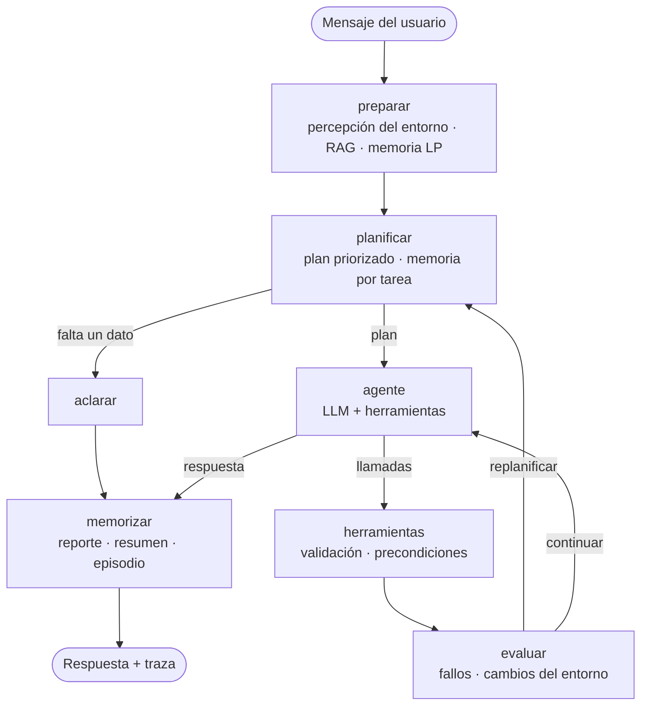

# Valor Food Agente

Agente de IA para **Valor Food**, un ERP gastronómico usado por Crispy House. Es un prototipo académico de la asignatura **ISY0101 Ingeniería de Soluciones con IA** (Duoc UC, sección 006D) y corresponde a la Evaluación Parcial 2, que continúa el asistente RAG de la EP1.

El agente resuelve un flujo organizacional concreto: **revisar el inventario, priorizar la reposición y preparar borradores de órdenes de compra**, recordando las preferencias del local y adaptándose cuando cambian las condiciones. También compara la facturación mensual y orienta sobre rutas del ERP.

> ⚠️ Inventario, ventas y órdenes son **datos simulados**. El agente no se conecta al ERP real y **no ejecuta compras**: solo genera borradores que una persona debe aprobar.

## Contenido

- [Qué hace el agente](#qué-hace-el-agente)
- [Arquitectura](#arquitectura)
- [Herramientas](#herramientas)
- [Memoria](#memoria)
- [Planificación y decisiones adaptativas](#planificación-y-decisiones-adaptativas)
- [Instalación y ejecución](#instalación-y-ejecución)
- [Pruebas y evidencia](#pruebas-y-evidencia)
- [Estructura del repositorio](#estructura-del-repositorio)
- [Limitaciones](#limitaciones)
- [Referencias](#referencias)

## Qué hace el agente

| Necesidad del local | Comportamiento del agente |
|---|---|
| Saber qué falta y qué es urgente | Consulta el stock y clasifica cada ingrediente como crítico, bajo u ok. |
| Preparar la compra | Genera un borrador de orden de compra (JSON y CSV) validado contra el inventario. |
| Que no haya que repetir reglas | Guarda preferencias (por ejemplo, «el pan no se pide, lo trae la panadería») y las aplica en conversaciones futuras. |
| Registrar mercadería recibida | Actualiza el stock simulado cuando el usuario lo informa. |
| Comparar meses | Calcula la facturación mensual y pide el año si falta. |
| Encontrar funciones del ERP | Recupera la documentación interna con RAG. |
| Información externa | Recurre a la búsqueda web solo como respaldo, citando las URL. |

## Arquitectura

El agente está orquestado con **LangGraph** (`StateGraph`) y usa herramientas de **LangChain**. El modelo es `openai/gpt-oss-20b` vía **Groq**, los embeddings son locales (**Sentence Transformers**), la búsqueda vectorial usa **FAISS** y la interfaz es **Streamlit**.



| Nodo | Función |
|---|---|
| `preparar` | Compara el stock actual con el último observado en la conversación, recupera documentación interna (RAG) y recuerdos de largo plazo. |
| `planificar` | Pide al LLM un plan estructurado (Pydantic), lo ordena por fase y prioridad y recupera las preferencias del tema de la tarea. Si el LLM falla, usa un planificador por reglas. |
| `aclarar` | Pregunta por un dato imprescindible que no está en la conversación ni en la memoria. |
| `agente` | Ejecuta el plan con llamadas a herramientas (ciclo ReAct). Verifica que no se omitan pasos de prioridad alta. |
| `herramientas` | Valida argumentos y precondiciones, ejecuta y marca el avance del plan. |
| `evaluar` | Revisa resultados: fallos, cambios de stock, datos faltantes y validaciones de escritura. Decide si replanificar. |
| `memorizar` | Guarda el reporte del turno, compacta conversaciones largas y registra el episodio en la memoria de largo plazo. |

El detalle de componentes, el estado del grafo, los diagramas de memoria y el diagrama de secuencia están en **[docs/arquitectura.md](docs/arquitectura.md)**.

## Herramientas

| Herramienta | Categoría | Qué hace |
|---|---|---|
| `consultar_inventario` | Consulta | Stock simulado y cantidad para llegar al mínimo. |
| `comparar_ventas` | Consulta | Facturación bruta mensual de un año (solo ventas `paid`). |
| `buscar_documentos` | Consulta | RAG sobre la documentación interna de Valor Food. |
| `recordar` | Consulta | Búsqueda semántica en la memoria de largo plazo. |
| `buscar_web` | Respaldo | Búsqueda DDGS con motivo obligatorio; resultados citados como `[WEB-n]`. |
| `priorizar_reposicion` | Razonamiento | Clasifica por cobertura del mínimo: crítico < 50 %, bajo < 100 %, ok. |
| `generar_orden_compra` | Escritura | Borrador JSON/CSV en `runtime/ordenes/`, validado contra el inventario. |
| `guardar_preferencia` | Escritura | Preferencia con tema en la memoria de largo plazo. |
| `registrar_recepcion` | Escritura | Suma mercadería recibida al stock simulado. |

Los cálculos se hacen en Python (`src/operations.py`) para que el modelo no invente cifras. Todos los argumentos se validan con Pydantic (`extra='forbid'`, rangos y largos).

## Memoria

| Tipo | Implementación | Para qué sirve |
|---|---|---|
| **Corto plazo** | `SqliteSaver` de LangGraph (`runtime/conversaciones.sqlite`), un hilo por `thread_id` | Continuidad dentro de una conversación: referencias como «el mes que me dijiste», aclaraciones resueltas en el turno siguiente y el último stock observado. Sobrevive al reinicio de la aplicación. |
| **Compactación** | Nodo `memorizar` | Sobre 20 mensajes, resume la parte antigua con el LLM, la elimina del estado y guarda el resumen como episodio. |
| **Largo plazo** | `LongTermMemory`: FAISS coseno + JSON (`runtime/memoria_largo_plazo.json`) | Preferencias, decisiones (órdenes generadas) y episodios compartidos entre conversaciones. Evita duplicados (similitud ≥ 0,90). |
| **Recuperación semántica** | En dos etapas | 1) por similitud con la pregunta (≥ 0,35); 2) por tema de las herramientas planificadas, con ranking semántico. |
| **RAG documental** | FAISS + manifiesto con hash del corpus y firma del modelo | Rutas y reglas documentadas del ERP. |

## Planificación y decisiones adaptativas

El plan se ordena por **fase** (consulta → respaldo → razonamiento → escritura) y dentro de cada fase por **prioridad** (alta → media → baja). Así nunca se escribe antes de tener los datos que respaldan la escritura.

| Condición del entorno | Reacción del agente |
|---|---|
| Falta el año para comparar ventas | Lo pregunta y usa la respuesta del turno siguiente. |
| El stock cambió fuera del agente entre turnos | Lo detecta antes de planificar y vuelve a consultar en lugar de reutilizar cifras. |
| El stock cambió durante el turno | El evaluador lo detecta y se replanifica. |
| La búsqueda web falla | Replanifica con fuentes internas y bloquea reintentos en ese turno. |
| Se intenta escribir sin leer el stock | La precondición rechaza la escritura. |
| Un ingrediente no tiene mínimo o no existe | Lo excluye y lo informa. |
| Cantidad excesiva | Rechaza (más de 5 veces el mínimo) o advierte (sobre lo necesario). |
| El LLM no entrega un plan válido | Usa el planificador por reglas. |
| Se omite un paso de prioridad alta | Exige ejecutarlo o justificar la omisión. |
| La respuesta cita fuentes web o URL que no existen en los resultados | El verificador de citas obliga a reescribirla (o la marca con una advertencia). |

Cada respuesta en la interfaz incluye un panel **«Cómo lo resolvió el agente»** con el plan y su estado, las decisiones de cada nodo, las observaciones del evaluador, las memorias recuperadas y la traza de herramientas, descargable en JSON.

## Instalación y ejecución

Requisitos: **Python 3.11 o 3.12** y una API key de Groq (gratuita en <https://console.groq.com/keys>).

```powershell
py -3.12 -m venv .venv
.\.venv\Scripts\python.exe -m pip install -r requirements.txt
Copy-Item .env.example .env        # luego editar GROQ_API_KEY
.\.venv\Scripts\python.exe create_vector_index.py
.\.venv\Scripts\python.exe -m streamlit run app.py
```

Variables principales del `.env`:

```env
LLM_PROVIDER=groq
GROQ_API_KEY=tu_clave
GROQ_MODEL=openai/gpt-oss-20b
EMBEDDING_PROVIDER=local
EMBEDDING_MODEL=sentence-transformers/paraphrase-multilingual-MiniLM-L12-v2
WEB_SEARCH_ENABLED=true
```

La primera ejecución descarga el modelo de embeddings (unos 470 MB). Si cambias el modelo o `data/documents.json`, vuelve a ejecutar `create_vector_index.py`.

### Recorrido sugerido en la interfaz

1. **Agente:** «Revisa el stock y prepárame una orden de compra con lo crítico».
2. «Recuerda que el pan nunca se incluye en las órdenes, lo trae la panadería».
3. **Nueva conversación:** «Genera una orden para reponer todo lo que falta». La preferencia se aplica.
4. **Entorno simulado:** cambia el stock de queso y guarda. Vuelve al chat y pide la orden del queso: el agente detecta el cambio.
5. **Memoria:** revisa los recuerdos guardados y el estado del hilo.

## Pruebas y evidencia

```powershell
.\.venv\Scripts\python.exe -m pytest                    # 34 pruebas, sin API
.\.venv\Scripts\python.exe evaluate.py --live --only E1 E4   # escenarios con el modelo real (opcional)
```

- **Pruebas automáticas** (`tests/`): usan un LLM programable (`ScriptedLLM`) y embeddings deterministas, de modo que cada mecanismo se verifica sin red. Cubren herramientas, RAG, memoria de corto y largo plazo, compactación, planificación, precondiciones, cambios del entorno, fallos y la interfaz.
- **Escenarios con el modelo real** (`evaluate.py`, opcional): ejecutan el agente completo con Groq, embeddings reales y DDGS, y guardan los resultados en `evidence/live-*/`. El plan gratuito de Groq admite 200.000 tokens diarios y cada turno consume entre 15.000 y 20.000, así que conviene correrlos en tandas.

El análisis de resultados está en **[docs/pruebas.md](docs/pruebas.md)**.

## Estructura del repositorio

```text
app.py                  Interfaz Streamlit (chat, entorno simulado, memoria)
evaluate.py             Escenarios reales con evidencia
create_vector_index.py  Construcción del índice FAISS documental
src/
  agent.py              Grafo LangGraph y nodos
  planner.py            Esquema de plan, priorización y planificador heurístico
  tools.py              Herramientas LangChain por categoría
  operations.py         Cálculos y escrituras deterministas
  memory.py             Checkpointer SQLite y memoria de largo plazo
  retrieval.py          RAG documental
  vectors.py            Utilidades FAISS compartidas
  prompts.py            Prompts del ejecutor y del resumen
  web_search.py         Búsqueda web DDGS
  settings.py           Configuración, LLM y embeddings
data/                   Datos semilla (inventario, ventas, documentos)
docs/                   Arquitectura, pruebas y fuentes
tests/                  Pruebas automáticas
evidence/               Evidencia de ejecuciones reales
runtime/                Estado local generado (ignorado por Git)
```

## Limitaciones

- Datos simulados: no hay integración con la base de datos del ERP.
- La reposición llega solo hasta el mínimo; no hay historial de consumo para pronosticar demanda.
- La calidad depende del LLM: los resultados en vivo varían entre ejecuciones y requieren revisión humana.
- Los umbrales de similitud (0,25 documentos, 0,35 memoria) no se calibraron con usuarios reales.
- La memoria de largo plazo es local y de un solo usuario; un uso multiusuario necesitaría separar por usuario y un almacén compartido.
- Los resultados web son extractos sin verificación de la página completa.

## Referencias

Ver [docs/fuentes.md](docs/fuentes.md) (formato APA).
