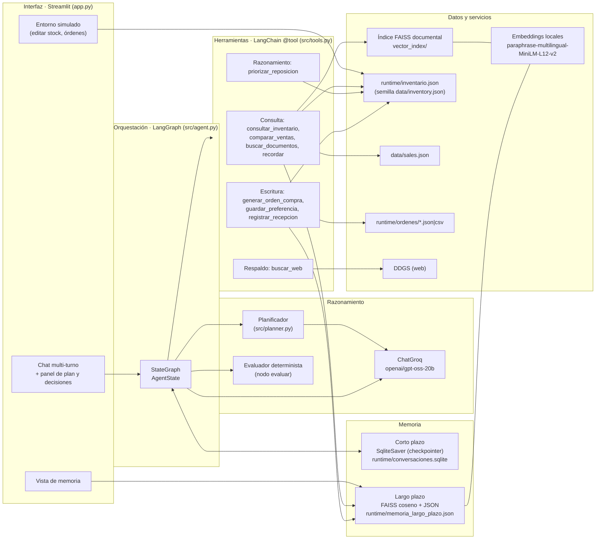
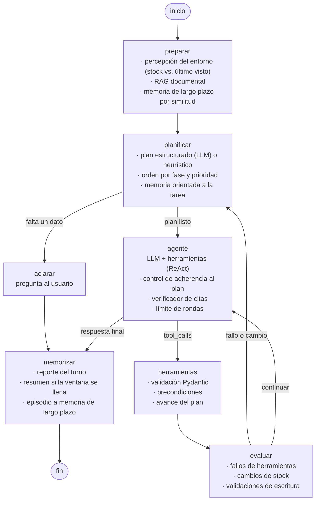
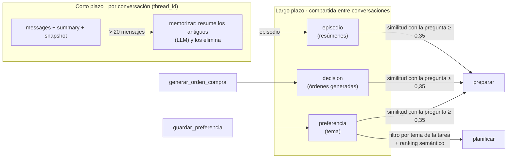
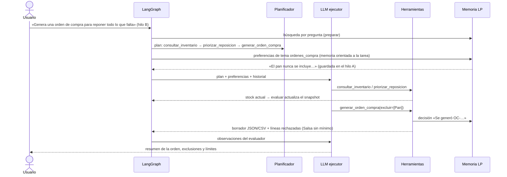

# Arquitectura del agente Valor Food (EP2)

Este documento describe la orquestación de componentes del agente. Complementa el
[README](../README.md) (ejecución) y [pruebas.md](pruebas.md) (evidencia).

## 1. Vista de componentes



| Módulo | Responsabilidad |
|---|---|
| `src/agent.py` | Grafo LangGraph: nodos, rutas condicionales, estado, límites y trazabilidad. |
| `src/planner.py` | Esquema de plan (Pydantic), orden por fase y prioridad, planificador heurístico de respaldo. |
| `src/tools.py` | Nueve herramientas con argumentos validados y categoría (consulta, respaldo, razonamiento, escritura). |
| `src/operations.py` | Cálculos deterministas sobre datos simulados: reposición, prioridad, órdenes, recepción, ventas. |
| `src/memory.py` | Checkpointer SQLite (corto plazo) y `LongTermMemory` con FAISS (largo plazo). |
| `src/retrieval.py` | RAG documental: fragmentación, índice FAISS con verificación de integridad, búsqueda con filtro. |
| `src/vectors.py` | Utilidades FAISS compartidas (normalización, `IndexFlatIP`, similitud coseno). |
| `src/prompts.py` | Prompt del ejecutor (zero-shot / few-shot) y prompt de resumen. |
| `src/web_search.py` | Búsqueda web de respaldo con DDGS. |

## 2. Grafo de orquestación (LangGraph)

Diagrama generado con `ValorFoodAgent.mermaid()` y anotado:



### Estado (`AgentState`)

| Campo | Alcance | Uso |
|---|---|---|
| `messages` | Persistente por hilo | Historial (reductor `add_messages`; admite `RemoveMessage` para compactar). |
| `summary` | Persistente por hilo | Resumen de los mensajes antiguos compactados. |
| `inventory_snapshot` | Persistente por hilo | Último stock observado: base para detectar cambios del entorno. |
| `reports` | Persistente por hilo | Reporte de cada turno (plan, decisiones, traza); reductor de concatenación. |
| `plan`, `observations`, `decisions`, `trace`, `rounds`, `replans`, … | Por turno | Se reinician en `preparar`. |

## 3. Memoria



- **Corto plazo:** `SqliteSaver` guarda un checkpoint por paso del grafo. Al reabrir la interfaz o
  cambiar de hilo, la conversación continúa donde quedó. Cuando un hilo supera `summary_trigger`
  mensajes, `memorizar` resume la parte antigua, la elimina del estado (cortando siempre al inicio de un
  turno para no separar llamadas de herramientas de sus resultados) y guarda el resumen como episodio.
- **Largo plazo:** cada recuerdo se guarda con tipo, tema, vector y fechas. La búsqueda usa FAISS
  `IndexFlatIP` sobre vectores unitarios (similitud coseno). Un recuerdo casi idéntico (≥ 0,90) del
  mismo tipo se actualiza en lugar de duplicarse. Si cambia el modelo de embeddings, los recuerdos se
  re-vectorizan al cargar.
- **Recuperación en dos etapas:** en `preparar` se buscan recuerdos parecidos a la pregunta. En
  `planificar`, según las herramientas del plan, se recuperan las preferencias de los temas
  relacionados (por ejemplo, `ordenes_compra` para `generar_orden_compra`). Esta segunda etapa se agregó
  porque, en la ejecución real, la pregunta «Genera una orden de compra para reponer todo lo que falta»
  tuvo similitud 0,15 con la preferencia «el pan nunca se incluye en las órdenes de compra…» y no se
  recuperaba con la búsqueda por pregunta (ver [pruebas.md](pruebas.md)).

## 4. Planificación y toma de decisiones

### Esquema de priorización

1. El LLM devuelve un `Plan` estructurado: objetivo, aclaración opcional y pasos con herramienta y
   prioridad (`alta`, `media`, `baja`).
2. `order_steps` ordena de forma determinista por **fase** de la herramienta y luego por **prioridad**:

| Fase | Herramientas | Motivo del orden |
|---|---|---|
| 0 · consulta | consultar_inventario, comparar_ventas, buscar_documentos, recordar | Se obtienen datos antes de actuar. |
| 1 · respaldo | buscar_web | Solo después de agotar las fuentes internas. |
| 2 · razonamiento | priorizar_reposicion | Opera sobre datos ya consultados. |
| 3 · escritura | generar_orden_compra, guardar_preferencia, registrar_recepcion | Al final, con datos verificados. |

3. Si el LLM falla o entrega un plan inválido, `heuristic_plan` genera uno por reglas (degradación controlada).

### Mecanismos de adaptación

| Condición | Dónde se detecta | Reacción |
|---|---|---|
| Falta un dato imprescindible (por ejemplo, el año) | `planificar` | Ruta a `aclarar`; el dato del turno siguiente se resuelve con la memoria de corto plazo. |
| El stock cambió entre turnos | `preparar` (percepción) | Observación «CAMBIO DE CONDICIONES» para el planificador y el ejecutor. |
| El stock cambió durante el turno | `evaluar` | Observación y replanificación. |
| Una herramienta falla (por ejemplo, la web) | `evaluar` | Replanificación; `buscar_web` queda bloqueada en el resto del turno. |
| Escritura sin lectura previa | `herramientas` (precondición) | Se rechaza con error; el ejecutor debe consultar primero. |
| Ingrediente sin mínimo o inexistente | `evaluar` | Observación para informar y excluir. |
| Cantidad sobre lo necesario o fuera de control | `operations` + `evaluar` | Advertencia o rechazo de la línea. |
| El ejecutor omite un paso de prioridad alta | `agente` | Se le exige una vez ejecutarlo o justificar la omisión. |
| Bucle de herramientas | `agente` | Tras `max_rounds` se fuerza una respuesta con lo obtenido. |
| La respuesta cita `[WEB-n]` o URL que no vienen de resultados reales | `agente` (verificador de citas) | Se exige reescribir sin esas citas; si persisten, se agrega una advertencia visible. Se agregó tras observar citas inventadas en la ejecución real de E6. |

Límites: `max_rounds=6`, `max_replans=2`, 6 llamadas por ronda y `recursion_limit=80`.

## 5. Ejemplo de flujo: reposición con preferencia guardada



## 6. Seguridad y límites

- Datos SIMULADOS. No hay conexión con el ERP de Crispy House y no se envían órdenes: solo se crean borradores.
- Las escrituras se validan contra el inventario (existencia, cantidad > 0, tope de 5 veces el mínimo, mínimo definido).
- Los resultados de herramientas, documentos y memorias entran al prompt como datos, no como instrucciones.
- Índices sin pickle: FAISS binario + JSON con hash del corpus, firma del modelo e integridad del archivo.
- `runtime/` está excluido de Git: contiene el estado mutable local (conversaciones, memoria, órdenes).

## 7. Boceto de interfaz

```text
┌───────────────┬───────────────────────────────────────────────────────────┐
│ Conversación  │ [Agente] [Entorno simulado] [Memoria] [Instrucciones]      │
│ Hilo: conv-…▾ │ 👤 Revisa el stock y prepárame una orden…                   │
│ [Nueva conv.] │ 🤖 Borrador OC-… con Queso 6 kg, Carne 6 kg…               │
│ Técnica ▾     │    ▸ Cómo lo resolvió: plan · decisiones · herramientas    │
│ Modelo, emb., │ 👤 …                                                        │
│ web           │ [ Escribe tu mensaje                                    ]  │
└───────────────┴───────────────────────────────────────────────────────────┘
```
