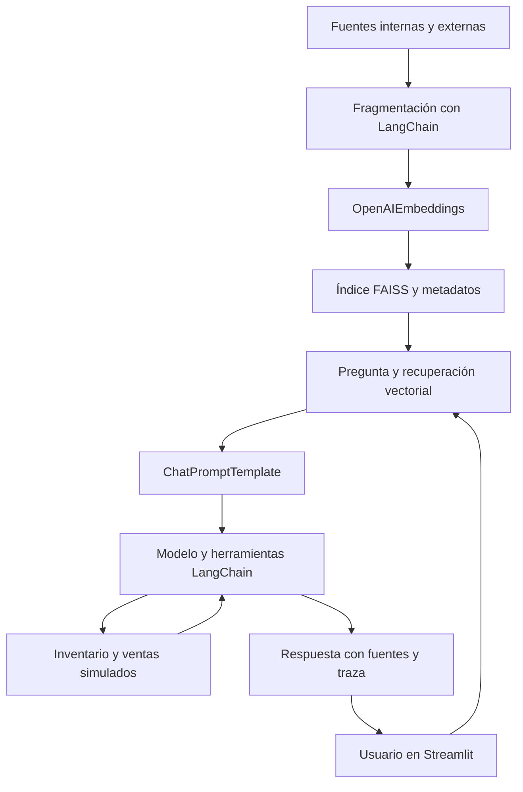

# Arquitectura del prototipo Python

La generación puede usar ChatOpenAI o ChatGroq. Los embeddings de producción usan OpenAI en ambos casos. La recuperación previa se ejecuta para cada pregunta y el agente puede solicitar otra búsqueda, incluida selección por tipo de fuente. Los cálculos son funciones Python con entradas validadas mediante Pydantic.

Las herramientas son de lectura y se limitan a inventario, ventas y documentos. El ciclo admite hasta cuatro rondas y seis llamadas por respuesta del modelo. Las instrucciones few-shot son ejemplos de aclaración y límites, no pruebas ni resultados de evaluación.

Boceto de interfaz: barra lateral con configuración y técnica; pestañas para consulta, revisión de datos sin IA e instrucciones; respuesta, fuentes desplegables y descarga JSON. No hay servicios de Node.js, React o Express en esta versión.

La persistencia del índice utiliza FAISS binario y JSON, con comprobación de modelo, hash del corpus e integridad del archivo. Crear el índice localmente; no abrir índices de origen desconocido. No hay MongoDB, Ragas ni métricas automáticas de fidelidad. La justificación de elecciones debe ser desarrollada por el estudiante.

## Fallback web internal-first (v0.3)

Flujo de prioridad: pregunta → datos estructurados internos / FAISS interno → si falta información → búsqueda web DDGS → LLM → respuesta. La web no sustituye ni completa cifras internas de stock o ventas; solo aporta información externa explícitamente identificada.
